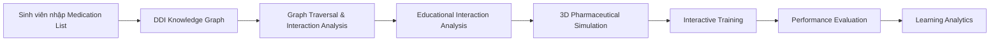

# Medical Pharmacology Learning & DDI Knowledge Graph Platform

## 1. Tổng quan dự án

### Tên đề tài

**Tiếng Việt**

> Xây dựng hệ thống hỗ trợ đào tạo Dược lâm sàng tích hợp Đồ thị tri thức tương tác thuốc và mô phỏng 3D tương tác thuốc.

**Tiếng Anh**

> Development of a Clinical Pharmacology Education System Integrating Drug–Drug Interaction Knowledge Graph and Interactive 3D Simulation.

---

## 2. Mục tiêu

Xây dựng một nền tảng Web phục vụ sinh viên Y/Dược và đào tạo Dược lâm sàng, tập trung vào hai hướng:

1. **Drug Knowledge & Drug–Drug Interaction (DDI)**
   - Tra cứu thuốc và hoạt chất.
   - Phân tích tương tác thuốc.
   - Biểu diễn quan hệ thuốc dưới dạng Knowledge Graph.
   - Phân tích tương tác đa thuốc (Polypharmacy).
   - Trực quan hóa mạng lưới tương tác.

2. **Interactive 3D Pharmaceutical Simulation**
   - Mô phỏng quy trình dược/pharmaceutical preparation ở mức giáo dục.
   - Tương tác với mô hình 3D.
   - Mô phỏng các thao tác theo kịch bản.
   - Đánh giá lỗi thao tác.
   - Đánh giá trải nghiệm người học.

Hệ thống được thiết kế cho **mục đích giáo dục và nghiên cứu**, không thay thế bác sĩ/dược sĩ và không được sử dụng như hệ thống tự động kê đơn hoặc quyết định điều trị bệnh nhân thật.

---

# 3. Ý tưởng nghiên cứu

Thay vì xây dựng:

```text
Drug
   ↓
Database
   ↓
Search
   ↓
Display Interaction
```

hệ thống tập trung vào:

```text
Drug Knowledge
       ↓
Knowledge Graph
       ↓
Graph Traversal
       ↓
Polypharmacy Analysis
       ↓
Risk / Interaction Pattern
       ↓
Network Visualization
```

Mục tiêu là biến phần DDI từ một **CRUD application** thành một bài toán có yếu tố:

- Graph Theory;
- Knowledge Graph;
- Network Science;
- Graph Traversal;
- Subgraph Analysis;
- Polypharmacy Analysis;
- Network Visualization.

---

# 4. Nguyên tắc dữ liệu

## 4.1. Không để dataset quyết định nội dung đào tạo

Không chọn thuốc theo kiểu:

> "ChCh-Miner có thuốc nào thì dùng thuốc đó."

Thay vào đó:

```text
Curriculum
+
ATC important groups
+
Common drugs in Vietnam
+
High-risk drugs
+
Educational importance
        ↓
Selected Drug Set
        ↓
150–200 drugs
```

Danh sách thuốc là **quyết định của nhóm nghiên cứu**.

---

# 5. Quy trình xây dựng tập thuốc

## Step 1 — Drug Selection

Tự xây dựng danh sách khoảng:

```text
150–200 drugs
```

Tiêu chí:

### Nhóm bệnh/điều trị

- Cardiovascular
- Antimicrobial
- CNS
- Endocrine
- Gastrointestinal
- Respiratory
- Analgesics
- Anticoagulants
- Antidiabetics
- Antihypertensives

### Nhóm có giá trị đào tạo cao

- Thuốc thường xuất hiện trong giáo trình Dược lý.
- Thuốc phổ biến trong thực hành.
- Thuốc có nhiều tương tác.
- Thuốc có cửa sổ điều trị hẹp.
- Thuốc liên quan đến CYP450.
- Thuốc có nhiều cơ chế tương tác.

Ví dụ:

- Digoxin
- Warfarin
- Vancomycin
- Phenytoin
- Carbamazepine
- Rifampicin
- Clarithromycin
- các thuốc tim mạch, kháng sinh, thần kinh, nội tiết...

Danh sách thực tế phải được xây dựng và kiểm tra với giáo trình/tài liệu chuyên môn.

---

# 6. Step 2 — Drug Identity Mapping

Chuẩn hóa tên thuốc:

```text
Vietnamese Name
       ↓
Generic Name
       ↓
PubChem CID
       ↓
DrugBank ID
       ↓
ATC Code
```

Tạo bảng/collection mapping:

```text
drug_identity_mapping
```

Ví dụ:

```json
{
  "drugName": "Digoxin",
  "normalizedName": "digoxin",
  "pubChemCid": "...",
  "drugBankId": "...",
  "atcCode": "C01AA05"
}
```

---

# 7. Step 3 — ChCh-Miner

ChCh-Miner **không phải knowledge base cuối cùng**.

Nó chỉ được sử dụng để:

> Candidate Interaction Generation

Quy trình:

```text
ChCh-Miner
      ↓
Interaction Edges
      ↓
Check Drug A
      ↓
Check Drug B
      ↓
Both ∈ Selected Drug Set?
      ↓
YES
      ↓
Candidate DDI
```

Ví dụ:

```text
Selected Drugs = 180
```

ChCh-Miner có:

```text
48,514 interaction pairs
```

Không dùng toàn bộ.

Chỉ giữ:

```text
Drug A ∈ Selected Drugs
AND
Drug B ∈ Selected Drugs
```

Kết quả có thể còn:

```text
50–150 candidate pairs
```

Con số thực tế phụ thuộc dữ liệu.

---

# 8. Step 4 — Evidence Verification

Mỗi candidate interaction phải được kiểm tra bằng nguồn chuyên môn.

Nguồn có thể bao gồm:

- RxNav / RxNorm;
- Dược thư Quốc gia;
- Medscape;
- PubMed;
- tài liệu chuyên ngành;
- guideline phù hợp;
- các nguồn chính thống khác được nhóm lựa chọn.

Thông tin cần xác minh:

```text
Drug A
Drug B
Severity
Mechanism
Clinical Effect
Management / Recommendation
Evidence
Reference
```

AI có thể hỗ trợ tạo bản nháp tiếng Việt nhưng:

> AI-generated content MUST NOT automatically become official medical knowledge.

Quy trình:

```text
Evidence
   ↓
AI Draft
   ↓
Human Reviewer
   ↓
Approved
   ↓
Database
```

---

# 9. Step 5 — Lưu dữ liệu chính thức

Kết quả cuối cùng được lưu trực tiếp vào database của hệ thống.

Không xây dựng một "dataset DDI" độc lập để sử dụng lâu dài.

ChCh-Miner chỉ phục vụ quá trình chuẩn bị dữ liệu.

Sau khi filtering:

```text
ChCh-Miner
    ↓
Candidate
    ↓
Verification
    ↓
Reviewer
    ↓
Official Knowledge Base
```

---

# 10. Kiến trúc dữ liệu tổng thể

```text
                   Medical Sources
                         │
       ┌─────────────────┼─────────────────┐
       │                 │                 │
   Dược điển          RxNav            PubMed
       │                 │                 │
       └─────────────────┼─────────────────┘
                         │
                         ▼
                Data Preparation
                         │
                         ▼
                Selected Drug Set
                         │
                         ▼
                  DDI Verification
                         │
                         ▼
              ┌────────────────────┐
              │  Official Database │
              │      MongoDB       │
              └─────────┬──────────┘
                        │
                        ▼
                 Knowledge Graph
                        │
             ┌──────────┴──────────┐
             ▼                     ▼
       Graph Analysis       Visualization
```

---

# 11. Knowledge Graph

## 11.1. Node

Các loại node chính:

```text
Drug
ActiveIngredient
DrugClass
Enzyme
ATCClass
Disease / Indication
Reference
```

---

## 11.2. Edge

Các quan hệ:

```text
Drug ──HAS_ACTIVE_INGREDIENT──> ActiveIngredient

Drug ──BELONGS_TO─────────────> DrugClass

Drug ──INTERACTS_WITH─────────> Drug

Drug ──INHIBITS───────────────> Enzyme

Drug ──INDUCES────────────────> Enzyme

Drug ──SUBSTRATE_OF───────────> Enzyme

Drug ──USED_FOR───────────────> Disease

Interaction ──SUPPORTED_BY────> Reference
```

---

# 12. Ví dụ Knowledge Graph

```text
                 ┌──────────────┐
                 │   Digoxin    │
                 └──────┬───────┘
                        │
                 HAS_ACTIVE_INGREDIENT
                        │
                        ▼
                 ┌──────────────┐
                 │   Digoxin    │
                 └──────────────┘

                        │
                  BELONGS_TO
                        │
                        ▼
                ┌────────────────┐
                │ Cardiac         │
                │ Glycoside       │
                └────────────────┘


      ┌──────────────┐
      │ Drug A       │
      └──────┬───────┘
             │
       INTERACTS_WITH
             │
             ▼
      ┌──────────────┐
      │ Digoxin      │
      └──────┬───────┘
             │
        SUBSTRATE_OF
             │
             ▼
      ┌──────────────┐
      │ CYP / P-gp   │
      └──────────────┘
```

---

# 13. Graph Database Strategy

## 13.1. MongoDB — System of Record

MongoDB vẫn là database chính của hệ thống:

```text
MongoDB
├── drugs
├── active_ingredients
├── drug_classes
├── interactions
├── references
├── users
├── quizzes
├── learning_progress
└── ...
```

MongoDB chịu trách nhiệm:

- CRUD;
- authentication;
- user data;
- learning data;
- medical knowledge;
- references;
- reviewer workflow.

---

## 13.2. Neo4j — Knowledge Graph Layer

Nếu nhóm muốn nhấn mạnh Graph Theory, sử dụng:

**Neo4j**

làm graph database chuyên dụng.

Kiến trúc:

```text
                  NestJS
                    │
          ┌─────────┴──────────┐
          ▼                    ▼
       MongoDB               Neo4j
    System of Record      Knowledge Graph
          │                    │
          │                    │
          └─────────┬──────────┘
                    ▼
             DDI Analysis
```

MongoDB và Neo4j không lưu hai bộ dữ liệu độc lập.

MongoDB là nguồn chính.

Neo4j là **projection/index phục vụ graph analysis**.

---

# 14. Đồng bộ MongoDB → Neo4j

Quy trình:

```text
MongoDB
   ↓
Approved Drug Data
   ↓
Graph Builder
   ↓
Neo4j
```

Chỉ dữ liệu:

```text
reviewStatus = APPROVED
```

mới được đưa vào Knowledge Graph.

Ví dụ:

```text
MongoDB:

Drug A
Drug B
Interaction A-B

        ↓

Neo4j:

(A:Drug)-[:INTERACTS_WITH]->(B:Drug)
```

---

# 15. Graph Algorithms

Đây là phần giúp module DDI có giá trị CNTT.

## 15.1. Neighbor Traversal

Tìm tất cả thuốc tương tác trực tiếp:

```text
Drug A
 ↓
1-hop neighbors
 ↓
Drug B
Drug C
Drug D
```

---

## 15.2. Multi-hop Traversal

Ví dụ:

```text
Drug A
 ↓
Enzyme
 ↓
Drug B
```

hoặc:

```text
Drug A
 ↓
Drug B
 ↓
Drug C
```

Giúp phát hiện quan hệ gián tiếp.

---

# 16. Polypharmacy Interaction

Đây là use case chính.

Sinh viên nhập:

```text
Drug A
Drug B
Drug C
Drug D
Drug E
```

Hệ thống tạo induced subgraph:

```text
       A
      / \
     /   \
    B-----C
     \   /
      \ /
       D
       |
       E
```

Hệ thống kiểm tra:

```text
A-B
A-C
A-D
A-E
B-C
B-D
B-E
C-D
C-E
D-E
```

Không nhất thiết mọi cặp đều tồn tại.

---

# 17. Interaction Network

UI:

```text
Selected Drugs:

☑ Digoxin
☑ Warfarin
☑ Clarithromycin
☑ Phenytoin
☑ Drug E
```

Click:

```text
Analyze
```

↓

```text
          Digoxin
          /     \
         /       \
    Warfarin   Drug E
       |
       |
   Clarithromycin
       |
   Phenytoin
```

Các cạnh thể hiện interaction.

---

# 18. Cumulative Risk Score

Có thể xây dựng **điểm nghiên cứu nội bộ** để xếp hạng mức độ phức tạp của một medication network.

Ví dụ:

```text
RiskScore =
Σ pairwise interaction weights
+
high-severity weight
+
polypharmacy factor
+
high-risk drug factor
```

Tuy nhiên:

> RiskScore của hệ thống là **chỉ số nghiên cứu/giáo dục**, không được trình bày như xác suất biến cố hoặc khuyến cáo điều trị lâm sàng nếu chưa có validation chuyên môn.

Ví dụ:

```text
Interaction severity:

Minor    → 1
Moderate → 2
Major    → 3
```

Sau đó:

```text
Total interaction score
=
Σ interaction weights
```

Có thể nghiên cứu thêm:

```text
Polypharmacy factor
=
f(number of drugs)
```

Nhưng công thức phải được nhóm định nghĩa rõ ràng và gọi là:

> Educational Interaction Complexity Score

thay vì:

> Patient Risk Score

nếu chưa có dữ liệu lâm sàng để validation.

---

# 19. Network Metrics

Có thể tính:

### Degree Centrality

Thuốc có nhiều tương tác nhất.

```text
Drug A
degree = 12
```

### Betweenness Centrality

Thuốc nằm trên nhiều đường đi giữa các node.

### Closeness Centrality

Đánh giá khoảng cách tới các node khác.

### Connected Components

Xác định các nhóm thuốc có liên kết với nhau.

### Community Detection

Tìm cluster:

```text
Cardiovascular cluster
CNS cluster
Antibiotic cluster
```

Không phải metric nào cũng cần đưa vào MVP.

---

# 20. D3.js Visualization

Frontend sử dụng:

**D3.js**

để hiển thị:

```text
Force-directed graph
```

Architecture:

```text
Neo4j
  ↓
Graph Query
  ↓
NestJS
  ↓
JSON
  ↓
Next.js
  ↓
D3.js
  ↓
Interactive Network
```

Node:

```text
Drug
```

Edge:

```text
Interaction
```

---

# 21. Visualization Interaction

Người dùng có thể:

- zoom;
- pan;
- drag node;
- click node;
- hide/show node;
- filter severity;
- filter drug class;
- xem reference;
- xem mechanism.

Ví dụ:

```text
Severity Filter

☐ Minor
☑ Moderate
☑ Major
```

Graph tự cập nhật.

---

# 22. Drug Detail → Knowledge Graph

Trang thuốc:

```text
Digoxin
────────────────────────

Basic Information

Active Ingredient

Drug Class

Mechanism

Interactions
    ↓

[View Knowledge Graph]
```

Click:

```text
View Graph
```

↓

```text
                 Drug B
                   │
                   │
Drug C ─────── Digoxin ─────── Drug D
                   │
                   │
                Enzyme
```

---

# 23. Clinical Case Integration

Module DDI có thể nhận dữ liệu từ Clinical Case.

```text
Clinical Case
      ↓
Medication List
      ↓
DDI Engine
      ↓
Knowledge Graph
      ↓
Interaction Network
      ↓
Educational Feedback
```

Ví dụ sinh viên được đưa một case giả lập:

```text
Patient Case
Medication:
A
B
C
D
```

Sinh viên phải:

1. xác định các cặp có interaction;
2. xác định mechanism;
3. giải thích ảnh hưởng;
4. xác định nguồn bằng chứng.

Mục tiêu là đánh giá **clinical reasoning trong môi trường giáo dục**, không phải đưa ra chỉ định điều trị bệnh nhân thật.

---

# 24. Module 3D

Module 3D:

```text
Next.js
   ↓
React Three Fiber
   ↓
Three.js
   ↓
WebGL
```

Chức năng:

- 3D visualization;
- interactive object;
- thao tác mô phỏng;
- animation;
- collision/event;
- error detection;
- scenario-based training.

---

# 25. Closed-loop Workflow

Hai module được kết nối:



Điểm quan trọng:

**Không nên mô tả hệ thống là "AI tự động điều chỉnh thuốc".**

Thay vào đó:

```text
DDI Analysis
      ↓
Educational Finding
      ↓
Simulation / Training Scenario
```

---

# 26. Tech Stack

## Frontend

```text
Next.js
TypeScript
Tailwind CSS
shadcn/ui
TanStack Query
React Hook Form
Zod
D3.js
Recharts
React Three Fiber
Three.js
```

## Backend

```text
Node.js
NestJS
TypeScript
Mongoose
Neo4j Driver
Passport.js
JWT
Swagger
Pino
```

## Database

### Primary

```text
MongoDB Atlas
```

### Graph

```text
Neo4j
```

## AI

```text
LLM API
LangChain.js
Embeddings
MongoDB Vector Search
```

AI là module nâng cao, không phải core dependency của DDI engine.

## Testing

```text
Jest
Vitest
React Testing Library
Supertest
Playwright
```

## DevOps

```text
Git
GitHub
GitHub Actions
Docker
Docker Compose
```

---

# 27. Docker Development Environment

Local development:

```text
docker-compose

├── mongodb
├── neo4j
└── backend
```

Frontend chạy:

```text
npm run dev
```

Có thể phát triển:

```text
Next.js
localhost:3000

NestJS
localhost:3001

MongoDB
localhost:27017

Neo4j
localhost:7474
```

---

# 28. Backend Architecture

```text
src/

├── auth/
├── users/
│
├── drugs/
├── ingredients/
├── drug-classes/
├── references/
│
├── interactions/
│
├── knowledge-graph/
│   ├── graph.service.ts
│   ├── graph.repository.ts
│   └── graph.mapper.ts
│
├── polypharmacy/
│   ├── analysis.service.ts
│   ├── traversal.service.ts
│   └── scoring.service.ts
│
├── learning/
├── quizzes/
├── flashcards/
├── clinical-cases/
│
├── ai/
│   ├── rag.service.ts
│   ├── embedding.service.ts
│   └── citation.service.ts
│
├── admin/
└── common/
```

---

# 29. DDI Engine

Module quan trọng:

```text
polypharmacy/
```

Có thể gồm:

```text
polypharmacy/
├── analysis.service.ts
├── traversal.service.ts
└── scoring.service.ts
```

Input:

```text
Drug[]
```

Process:

```text
1. Validate drugs
2. Build subgraph
3. Find direct interactions
4. Find relevant multi-hop relationships
5. Calculate interaction complexity
6. Rank important interactions
```

Output:

```json
{
  "nodes": [],
  "edges": [],
  "metrics": {
    "drugCount": 3,
    "interactionCount": 2,
    "complexityScore": 5
  }
}
```

---

# 30. Neo4j Query Example

Graph:

```text
(:Drug)-[:INTERACTS_WITH]->(:Drug)
```

Có thể truy vấn:

```cypher
MATCH (d:Drug {name: $drugName})
      -[r:INTERACTS_WITH]-
      (other:Drug)
RETURN d, r, other
```

Polypharmacy:

```cypher
MATCH (d:Drug)
WHERE d.id IN $drugIds

MATCH (d)-[r:INTERACTS_WITH]-(other:Drug)

WHERE other.id IN $drugIds

RETURN d, r, other
```

Kết quả chính là **induced interaction subgraph** của danh sách thuốc.

---

# 31. Reviewer Workflow

```text
Data Candidate
      ↓
Reviewer Dashboard
      ↓
Check Drug Identity
      ↓
Check Interaction
      ↓
Check Mechanism
      ↓
Check Severity
      ↓
Check Evidence
      ↓
Approve
      ↓
MongoDB
      ↓
Neo4j Graph Sync
```

---

# 32. Evidence Management

Mỗi interaction cần:

```text
interaction
├── severity
├── mechanism
├── effect
├── educationalExplanation
└── evidenceSources[]
```

Ví dụ:

```json
{
  "severity": "major",
  "mechanism": "...",
  "effect": "...",
  "evidenceSources": [
    {
      "sourceType": "RxNav",
      "sourceId": "..."
    },
    {
      "sourceType": "PubMed",
      "sourceId": "..."
    }
  ]
}
```

---

# 33. Security

Hệ thống phải có:

```text
Authentication
Authorization
Input Validation
Rate Limiting
Audit Logging
HTTPS
Secure Cookies
Password Hashing
```

Không lưu password plaintext.

Sử dụng:

```text
Argon2
```

hoặc bcrypt.

---

# 34. Audit Log

Các thao tác quan trọng:

```text
Reviewer approved interaction
Reviewer modified interaction
Admin created drug
Admin changed reference
```

Lưu:

```json
{
  "userId": "...",
  "action": "APPROVE_INTERACTION",
  "entityType": "Interaction",
  "entityId": "...",
  "timestamp": "..."
}
```

---

# 35. Research Evaluation

Không chỉ đánh giá:

> "Website chạy được."

Cần đánh giá ở nhiều tầng.

## 35.1. System Performance

- API latency;
- graph query latency;
- search latency;
- visualization rendering;
- database performance.

## 35.2. Graph Algorithm

- number of interactions found;
- graph traversal performance;
- centrality calculation;
- correctness against verified interaction set.

## 35.3. Knowledge Quality

- reviewer agreement;
- citation correctness;
- completeness;
- data consistency.

## 35.4. Usability

Có thể dùng:

**SUS — System Usability Scale**

để đánh giá hệ thống.

## 35.5. Cognitive Load

Có thể nghiên cứu:

**NASA-TLX**

đặc biệt phù hợp với module mô phỏng 3D.

---

# 36. Research Questions

### RQ1

> Can a Knowledge Graph effectively represent drug–drug interaction relationships for pharmacology education?

### RQ2

> Can graph traversal identify interaction patterns in polypharmacy scenarios?

### RQ3

> Does graph-based visualization improve students' understanding of complex drug interaction networks?

### RQ4

> Does interactive 3D simulation improve students' perceived usability and learning experience?

### RQ5

> Does the integrated platform improve students' ability to identify and explain drug-related problems?

---

# 37. Hypotheses

### H1

Knowledge Graph visualization improves students' ability to identify DDI relationships compared with conventional tabular presentation.

### H2

Graph-based polypharmacy analysis can identify relevant interaction edges among selected medications.

### H3

Interactive network visualization improves students' understanding of complex DDI relationships.

### H4

Interactive 3D simulation improves perceived engagement and usability.

---

# 38. Project Phases

## Phase 1 — Requirements

```text
SRS
Use Case
User Story
Architecture
Database Design
```

## Phase 2 — Drug Knowledge Base

```text
Select 150–200 drugs
↓
Normalize names
↓
Map IDs
↓
Collect references
```

## Phase 3 — DDI Data Preparation

```text
ChCh-Miner
↓
Filter selected drugs
↓
Candidate interactions
↓
Evidence verification
↓
Reviewer approval
```

## Phase 4 — MongoDB

```text
Drug
Ingredient
DrugClass
Interaction
Reference
User
```

## Phase 5 — Knowledge Graph

```text
MongoDB
↓
Graph Builder
↓
Neo4j
↓
Cypher
↓
Graph Analysis
```

## Phase 6 — DDI Visualization

```text
D3.js
↓
Force-directed Graph
↓
Filtering
↓
Interaction Details
```

## Phase 7 — Learning System

```text
Quiz
Flashcards
Clinical Cases
Learning Progress
```

## Phase 8 — 3D Simulation

```text
React Three Fiber
↓
Scenario
↓
Interaction
↓
Error Detection
↓
Feedback
```

## Phase 9 — AI/RAG

```text
Medical Documents
↓
Chunking
↓
Embedding
↓
Vector Search
↓
LLM
↓
Evidence-grounded Answer
```

## Phase 10 — Evaluation

```text
Functional Testing
Performance Testing
Graph Validation
Usability Testing
Learning Evaluation
```

---

# 39. MVP

Nếu thời gian hạn chế, MVP phải là:

```text
1. Authentication

2. Drug Library

3. Drug Detail

4. Drug Interaction

5. Reviewer Dashboard

6. Evidence Sources

7. MongoDB

8. Neo4j Knowledge Graph

9. Polypharmacy Graph Analysis

10. D3.js Visualization
```

Sau khi MVP ổn định:

```text
+
Quiz
+
Flashcards
+
Clinical Cases
```

Cuối cùng:

```text
+
AI/RAG
+
3D Simulation
```

---

# 40. Những thứ KHÔNG nên làm

Không xây dựng:

```text
❌ Automatic diagnosis
❌ Automatic prescription
❌ Automatic dosage adjustment
❌ "AI quyết định thuốc nào nên dùng"
❌ "AI quyết định đổi thuốc"
❌ Patient-facing medical advice
```

Thay vào đó:

```text
DDI Analysis
       ↓
Evidence
       ↓
Educational Explanation
       ↓
Student Learning
```

---

# 41. Narrative khi bảo vệ đồ án

Câu chuyện nên trình bày:

> "Chúng em không xây dựng một website CRUD tra cứu tương tác thuốc."

Mà:

> "Chúng em xây dựng một nền tảng đào tạo Dược lâm sàng, trong đó quan hệ giữa thuốc, hoạt chất, nhóm thuốc và enzyme được mô hình hóa dưới dạng Knowledge Graph."

Tiếp theo:

> "Khi sinh viên nhập nhiều thuốc, hệ thống xây dựng một subgraph tương ứng với medication list và sử dụng graph traversal để phát hiện các quan hệ tương tác."

Sau đó:

> "Mạng lưới tương tác được trực quan hóa bằng force-directed graph, giúp sinh viên quan sát trực tiếp cấu trúc tương tác thay vì chỉ đọc một bảng dữ liệu."

Cuối cùng:

> "Kết quả phân tích DDI được kết nối với module mô phỏng 3D và learning analytics để tạo thành một closed-loop educational workflow."

---

# 42. Kiến trúc cuối cùng

```text
                         STUDENT
                            │
                            ▼
                    ┌───────────────┐
                    │    Next.js    │
                    └───────┬───────┘
                            │
                         REST API
                            │
                            ▼
                    ┌───────────────┐
                    │    NestJS     │
                    └───────┬───────┘
                            │
             ┌──────────────┼──────────────┐
             │              │              │
             ▼              ▼              ▼
         MongoDB         Neo4j           AI/RAG
       System Data     Knowledge Graph    Layer
             │              │              │
             │              ▼              │
             │        Graph Analysis       │
             │              │              │
             └──────────────┼──────────────┘
                            │
                            ▼
                    Learning Platform
                            │
              ┌─────────────┴─────────────┐
              │                           │
              ▼                           ▼
       DDI Visualization            3D Simulation
            D3.js                  R3F / Three.js
              │                           │
              └─────────────┬─────────────┘
                            ▼
                     Learning Analytics
```

---

# 43. Kết luận chiến lược

Hướng kiến trúc cuối cùng của dự án là:

```text
Evidence-based Medical Knowledge
              ↓
        MongoDB
              ↓
      Knowledge Graph
              ↓
          Neo4j
              ↓
     Graph Algorithms
              ↓
    Polypharmacy Analysis
              ↓
       D3 Visualization
              ↓
      Student Learning
              ↓
    3D Interactive Simulation
              ↓
       Learning Analytics
```

**Vai trò của ChCh-Miner:**

```text
Candidate Generator
        ↓
       END
```

Không phải:

```text
Main Database
```

**Vai trò của MongoDB:**

```text
Official System of Record
```

**Vai trò của Neo4j:**

```text
Graph Representation
+
Traversal
+
Network Analysis
```

**Vai trò của D3.js:**

```text
Graph Visualization
```

**Vai trò của AI:**

```text
Evidence-grounded Educational Assistant
```

**Vai trò của 3D:**

```text
Interactive Educational Simulation
```

Với cách phân chia này, dự án có thể được trình bày như một hệ thống kết hợp **Software Engineering + Knowledge Graph + Network Science + Medical Informatics + Educational Technology + WebGL**, thay vì chỉ là một website CRUD tra cứu thuốc.
